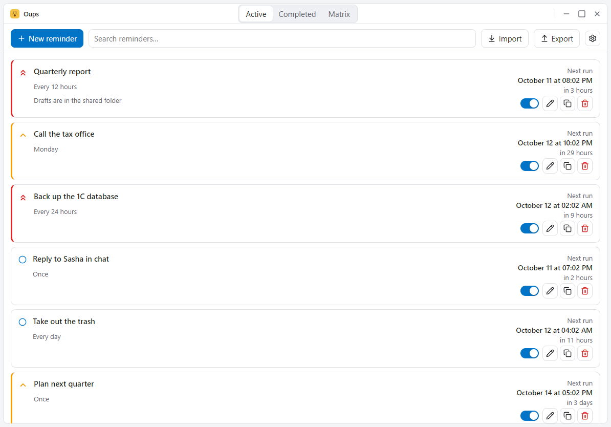
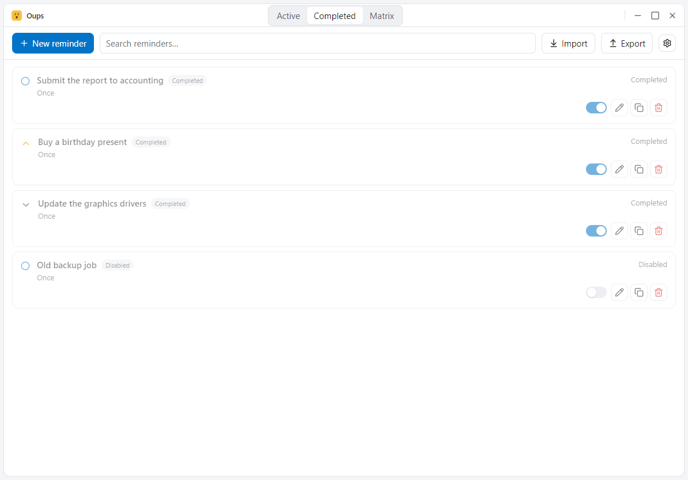
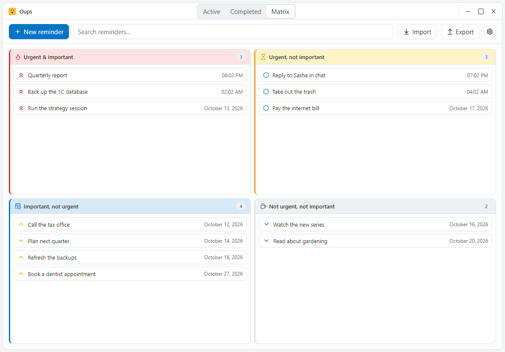
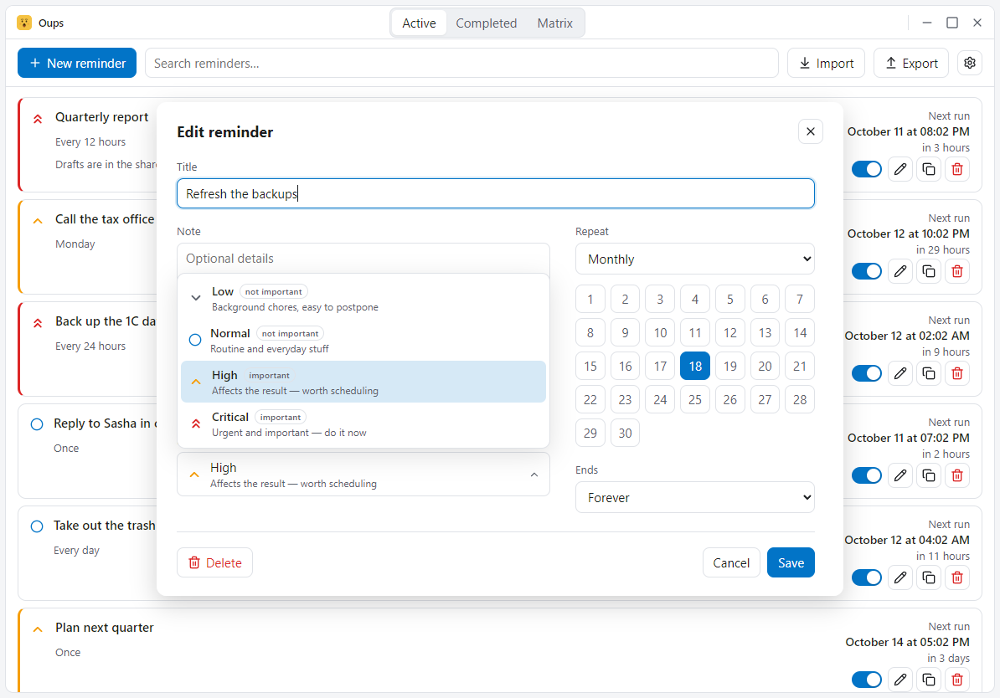
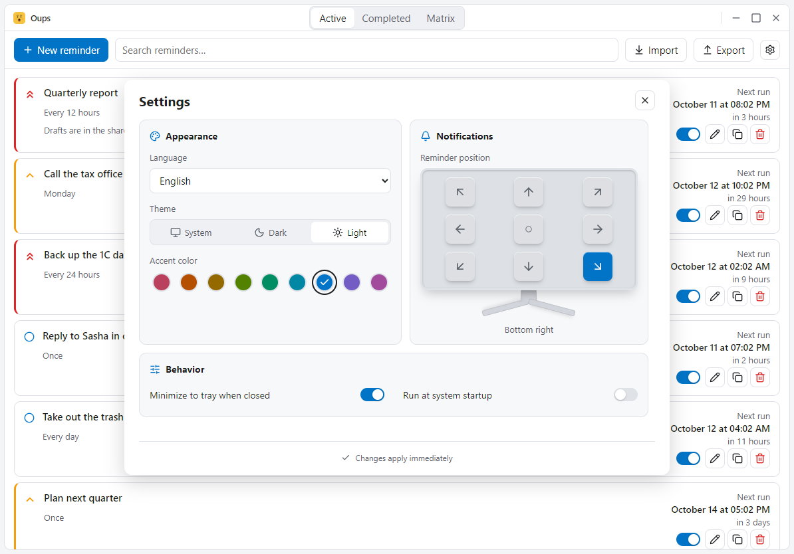
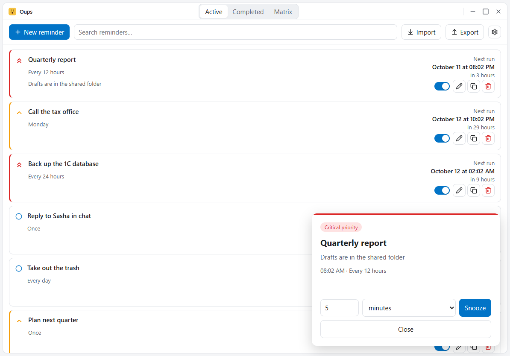
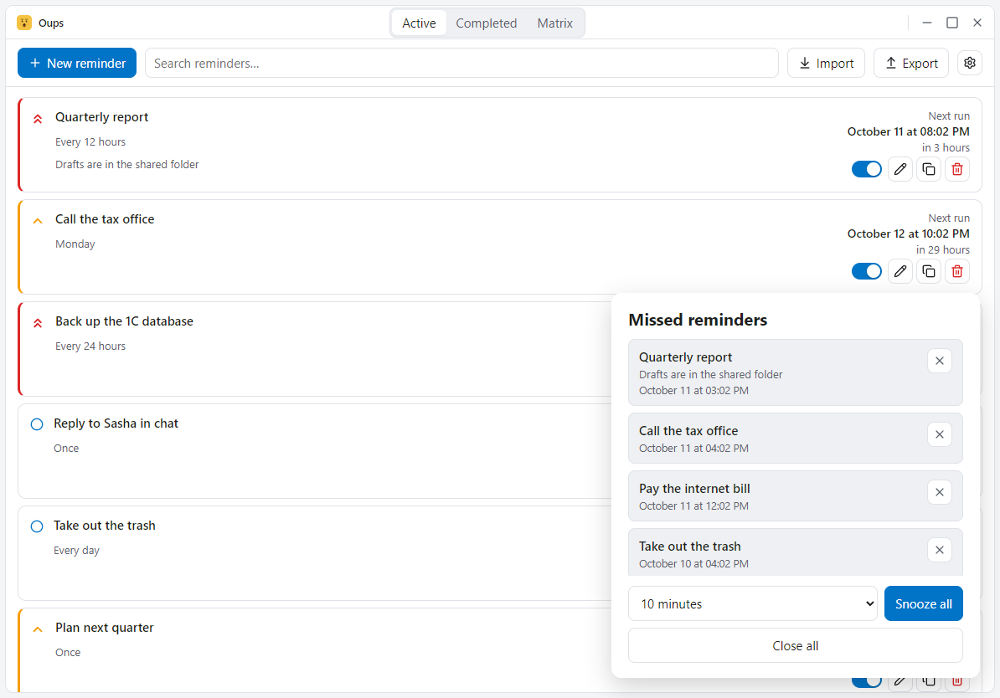

# Oups

**English** | [Русский](README.ru.md)

Reminders app for Windows, macOS and Linux: a popup appears on your screen
at the right moment — once or on a schedule. On Windows it is a portable app
with no installer: one executable, one SQLite database, locale files — all in
a single folder. macOS and Linux get the usual .app/.dmg and .deb/AppImage
packages. Built with Tauri 2 + Svelte 5.

## Features

- Reminders with date/time, title, note and four priority levels (low, normal,
  high, critical) chosen from a dropdown in the editor.
- Notes stay plain text, but `http://`, `https://`, `mailto:` and `www.` links
  inside them become clickable and open in your default browser.
- Recurrence: once, daily, weekday picker (Mon–Sun), monthly on day N (clamped
  to the month length), yearly (Feb 29 → Feb 28), or every N minutes / hours /
  days / weeks / months / years.
- End conditions: forever, after N occurrences, or until a date (inclusive).
- Popup at due time, always on top, with a custom snooze interval of 1–9999
  minutes / hours / days / weeks / calendar months (5 minutes by default), or
  close. A reminder never opens a second popup while one is already on screen.
- Popups appear in a configurable screen position (corners, edge centers,
  center) and stack like a card deck
  (each next popup shifts aside instead of covering the previous one).
- Snoozed firings snap back to the recurrence grid — a 15-minute interval never
  drifts because you hit snooze.
- Missed reminders (the PC was off or asleep) collapse into a single
  "missed" list at startup: snooze all, close all, or dismiss one by one.
- Tray icon with a localized menu; the close button hides to tray
  (configurable); optional run-at-startup with the main window hidden
  (Windows registry, macOS LaunchAgent, Linux desktop entry). After moving the
  app folder, launch it once from the new location to update the enabled
  autostart entry automatically.
- Search and filters, JSON import/export and import of Wise Reminder data files
  — *.dat from Wise Reminder 1.x (CP1251 INI with Delphi TDateTime stamps) and
  *.wrm from Wise Reminder 2.x (JSON envelope); the format is picked from the
  file extension — plus one-click reminder duplication (opens the editor
  pre-filled).
- Three view tabs: Active, Completed and Matrix. The Matrix lays the active
  reminders out on the 2×2 Eisenhower grid — the quadrant comes from priority
  alone, the level you picked (or dragged the card to); the schedule never moves
  a reminder between quadrants. Urgency is derived from the due time (overdue,
  or less than 24 hours left) and drives the order instead: overdue items float
  to the top of their quadrant. Search filters the whole grid, and clicking a
  card opens the editor.
- UI languages come from the `locales/*.json` folder itself — every file
  declares its own code and native display name, so adding a language is
  dropping a file next to the exe. Seven languages ship with the app: English,
  German, Spanish, Polish, Russian, Ukrainian and Arabic. On first run the
  system language is picked automatically when a matching locale exists.
  English is embedded in the exe as a fallback, so deleting the folder never
  breaks it.
- On Windows an optional `oups.wav` next to the executable plays a sound when
  a reminder fires; without the file the app stays silent.
- UI theme: system / dark / light, plus nine accent colors evenly spaced
  around the color wheel (constant perceptual lightness, hue step 40°).
- Frameless main window: no system title bar — the app draws its own frame with
  rounded corners and its own minimize, maximize and close buttons. On Windows
  the window still keeps its shadow, resizing, edge snapping and taskbar
  behavior, and on Windows 11 the system material (Mica) shows through the
  frame.
- The window opens centered and sized for the monitor's work area, so the
  taskbar stays visible, a small screen still fits it and a large one gets a
  proportionally bigger window; display scaling is taken into account.
- Single instance: launching the app twice just reveals the existing window.

## Screenshots

Every screen below is captured with the English interface — click a thumbnail
for the full-size file. The Russian equivalents are in
[README.ru.md](README.ru.md).

| Area | |
| --- | --- |
| Reminder list | [](screenshots/01-list.en.png) |
| Completed | [](screenshots/02-completed.en.png) |
| Eisenhower matrix | [](screenshots/03-matrix.en.png) |
| Reminder editor | [](screenshots/04-editor.en.png) |
| Settings | [](screenshots/05-settings.en.png) |
| Reminder popup | [](screenshots/07-popup.en.png) |
| Missed reminders | [](screenshots/08-popup-missed.en.png) |

The demo data in the screenshots is made up, not taken from a real database.

## Portable data layout

Everything lives next to the executable:

- `reminders.db` — SQLite (WAL), created on first run;
- `locales/*.json` — UI strings (en, de, es, pl, ru, uk, ar);
- `oups.wav` — optional sound file, only used on Windows.

Run it from any writable folder — not Program Files, the database needs write
access. In dev mode (`pnpm tauri dev`) the database and locales are taken from
the project root. Installed macOS and Linux packages keep the database in the
per-user app-data folder, because the application folder itself is read-only
there.

## Development

Requirements: Node 20+, pnpm, Rust (MSVC toolchain on Windows) and the
platform's webview runtime — WebView2 on Windows 10/11 (preinstalled) or
webkit2gtk-4.1 on Linux.

```bash
pnpm install
pnpm tauri dev        # run with hot reload
pnpm check            # svelte-check
pnpm lint             # Biome (lint + format for TS/JS/JSON)
pnpm test             # TypeScript tests (vitest)
pnpm check:all        # everything: lint + svelte-check + vitest + fmt + clippy + cargo test
pnpm tauri build --no-bundle   # release exe: src-tauri/target/release/scheduler.exe
pnpm dist             # release build + portable zip into dist/
pnpm demo             # regenerate the demo templates (dates resolve on import)
pnpm shots            # regenerate the screenshots in screenshots/
```

`pnpm dist` produces the Windows portable zip. The macOS (.app/.dmg) and Linux
(.deb/AppImage) packages are built by the release workflow in
`.github/workflows/build.yml`, which bundles `locales/` into the app resources.

`pnpm build` also runs `pnpm bundle:metadata`. It generates Linux AppStream
metadata and localized macOS `Credits.html` files in `src-tauri/gen/bundle/`.
The name comes from `tauri.conf.json`, the version, author and license from
`Cargo.toml`, and the descriptions and screenshot captions from
`distribution.*` in `locales/*.json`. Package descriptions in the Tauri config
match the English locale. Release dates use `SOURCE_DATE_EPOCH` when set,
otherwise the latest Git commit date, so rebuilding a revision is reproducible.

Both Linux packages carry AppStream metadata, the license and a stock icon;
AppStream links to the existing English and Russian screenshots on GitHub.
Opening a local `.deb` before installation can still show a limited card in
Ubuntu App Center; a full pre-install listing needs repository AppStream data.
macOS uses its native `.icns` icon, category and copyright in `Info.plist`,
plus localized credits with an offline screenshot gallery and the MIT license
inside `Contents/Resources`. These bundle files do not publish a Mac App Store
listing. The release workflow validates the metadata in the built packages.

Rust tests (recurrence engine, scheduler decisions, locale fallback):

```bash
cd src-tauri && cargo test
```

The release build optimizes for size (`opt-level = "s"`, LTO, strip);
`scripts/dist.mjs` additionally compresses the exe with UPX when `upx` is on
PATH. The app version lives only in `src-tauri/Cargo.toml`; the display name
only in `tauri.conf.json` (`productName`).

## Architecture

```
src/                Svelte frontend
  App.svelte            main window (toolbar, list, matrix, dialogs)
  EditorWindow.svelte   standalone reminder editor
  SettingsWindow.svelte standalone settings modal
  Popup.svelte          reminder popup + missed-reminders window
  components/           Toolbar, TitleBar, ReminderList, ReminderRow, ReminderEditor,
                        RecurrencePicker, PriorityPicker, MonthDayPicker, NoteLinks,
                        EisenhowerMatrix, Settings, WindowControls
  lib/api.ts            typed invoke wrappers
  lib/i18n.svelte.ts    reactive t() + language loading
  lib/state.svelte.ts   reminders store + live updates
  lib/clock.svelte.ts   shared UI clock (30 s tick)
  lib/theme.ts          data-theme / data-accent application
  lib/time.ts           parsing, Intl formatting, recurrence descriptions
  lib/plural.ts         plural forms via Intl.PluralRules
  lib/matrix.ts         Eisenhower quadrant rules
  lib/toolbar-layout.ts toolbar layout from measured widths
  lib/links.ts          link detection inside notes
src-tauri/
  src/model.rs          Reminder, Recurrence, EndMode (serde-tagged enums)
  src/recurrence.rs     next-occurrence math (+ unit tests)
  src/scheduler.rs      10 s tick, popup windows, snooze, startup catch-up
  src/db.rs             rusqlite schema/CRUD
  src/settings.rs       settings struct, load/save, validation
  src/commands.rs       all Tauri commands
  src/sound.rs          optional Windows reminder sound
  src/startup.rs        --autostart detection, ready fallback
  src/editor_window.rs  editor draft and duplication
  src/modal_window.rs   native modality + screen-aware sizing for editor/settings
  src/backdrop.rs       Windows 11 system material (Mica)
  src/wise.rs           Wise Reminder 1.x *.dat import (CP1251 INI + TDateTime)
  src/wrm.rs            Wise Reminder 2.x *.wrm import (JSON envelope)
  src/tray.rs           tray icon + localized menu
  src/window_size.rs    main window's launch size (from the work area) and centering
  src/locale.rs         Rust-side dictionary; embedded English fallback
  src/paths.rs          data dir: the exe folder when writable, else the app-data dir
```

How firing works: the database stores `next_due` as local wall-clock time
(`YYYY-MM-DDTHH:MM:SS`, so lexicographic order equals chronological order).
Every 10 seconds the scheduler picks up due reminders, opens one popup each,
and immediately computes the next occurrence — from the fired slot, not from
"now", which is why snooze never shifts interval grids.

## Contributing

Rules for humans and agents (versioning, language policy, tests, theming
contract, size budget) are documented in [AGENTS.md](AGENTS.md). Any change
must leave `pnpm check:all` green.

## License

MIT
