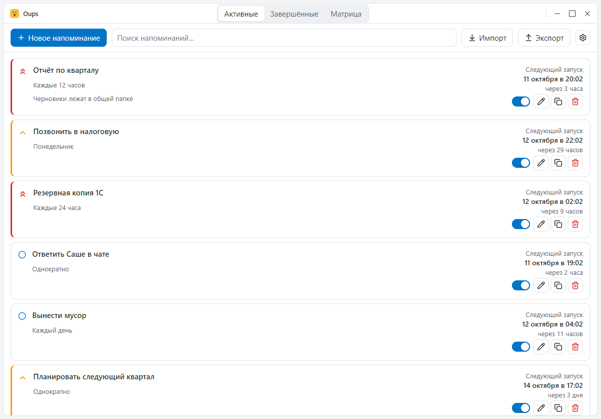
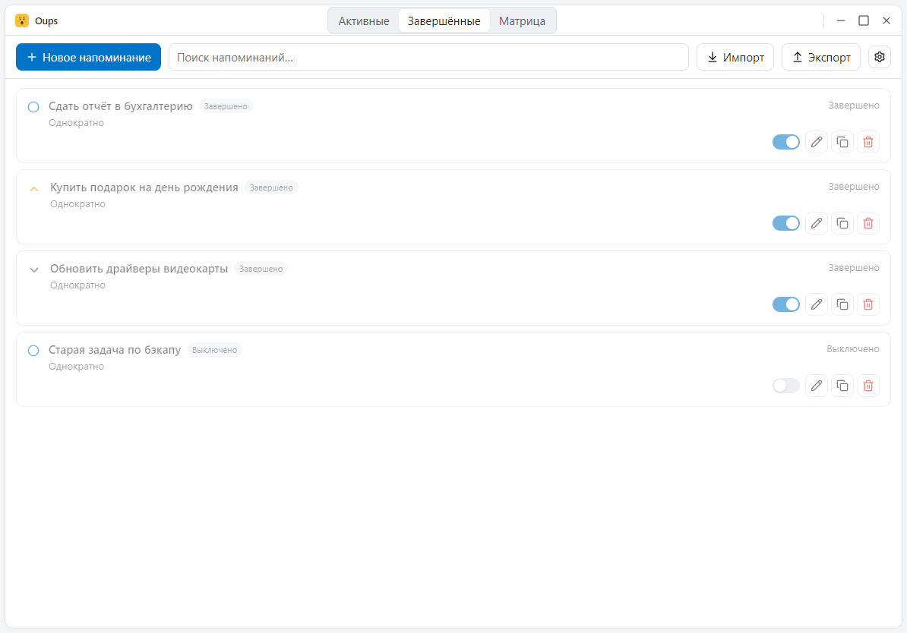
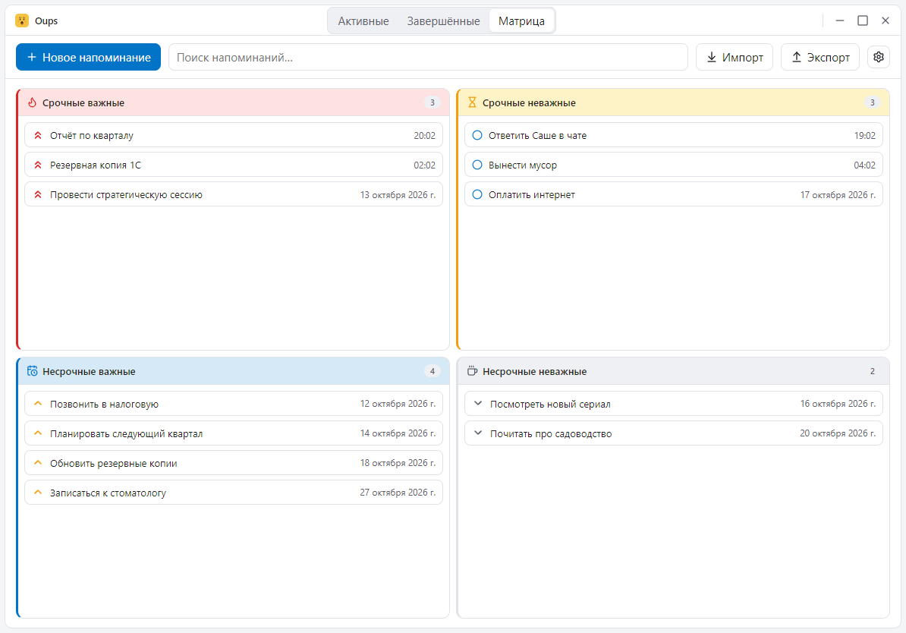
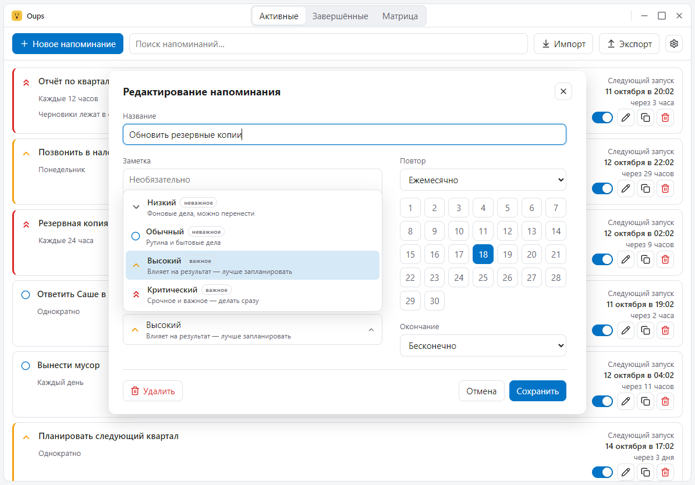
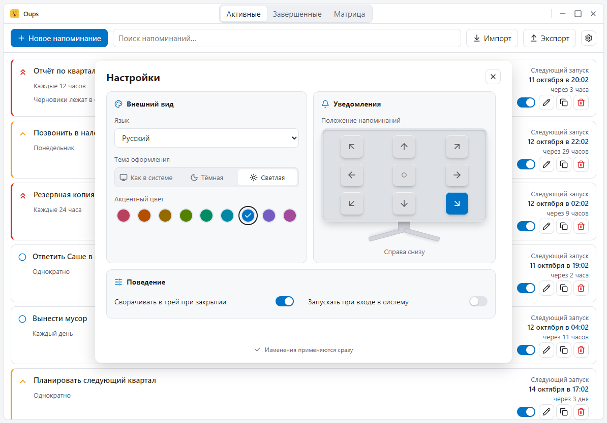
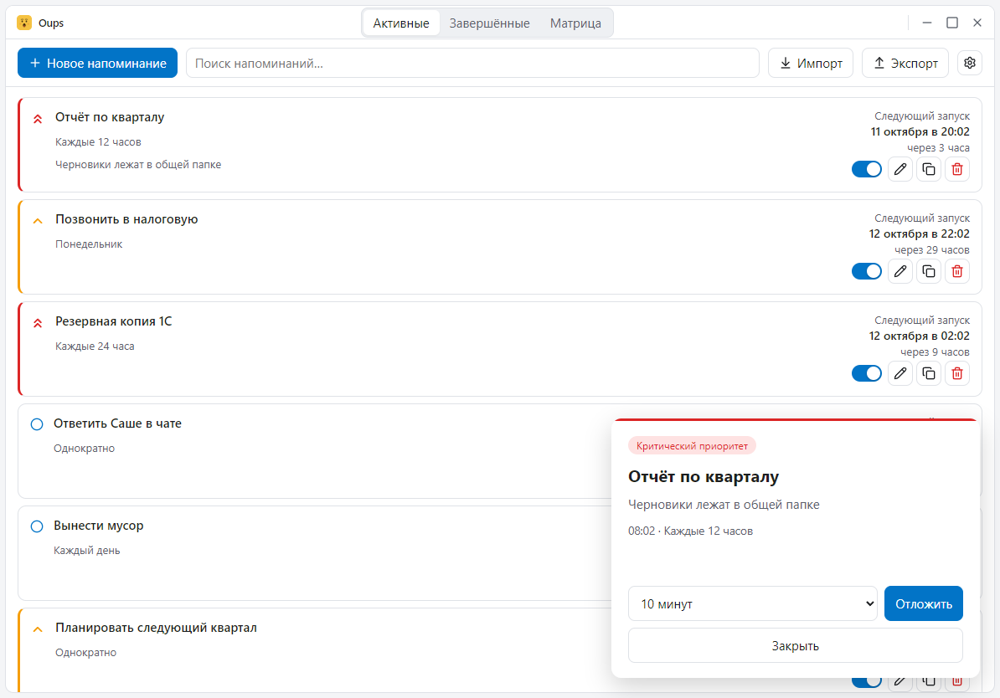
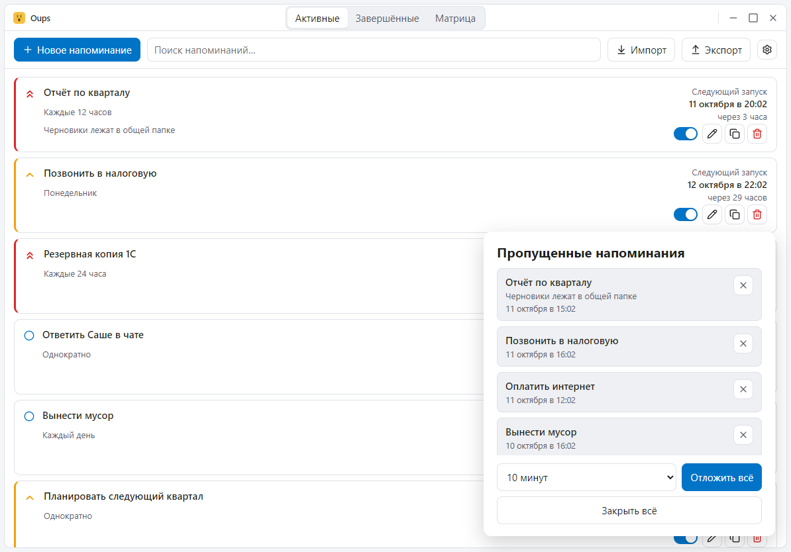

# Oups

[English](README.md) | **Русский**

Приложение-планировщик напоминаний для Windows, macOS и Linux: всплывающее
окно появляется на экране в нужный момент — один раз или по расписанию.
В Windows это портативное приложение без установщика: один exe, одна база
SQLite, файлы локализации — всё в одной папке. Для macOS и Linux собираются
обычные пакеты .app/.dmg и .deb/AppImage. Собрано на Tauri 2 + Svelte 5.

## Возможности

- Напоминания с датой/временем, названием, заметкой и одним из четырёх уровней
  приоритета (низкий, обычный, высокий, критический), которые выбираются из
  раскрывающегося списка в редакторе.
- Заметка остаётся обычным текстом, но ссылки `http://`, `https://`, `mailto:`
  и `www.` внутри неё становятся кликабельными и открываются в браузере по
  умолчанию.
- Повторы: однократно, ежедневно, по дням недели (Пн–Вс), ежемесячно N-го
  числа (с клампом к длине месяца), ежегодно (29 февраля → 28 февраля) или
  каждые N минут / часов / дней / недель / месяцев / лет.
- Окончание повторов: бесконечно, после N повторов или до даты (включительно).
- Всплывающее окно в срок, поверх всех окон, с откладыванием (5/10/15/30/60
  минут, сутки) или закрытием. Второй попап того же напоминания не открывается,
  пока на экране первый.
- Положение попапов настраивается (любой угол экрана), несколько окон
  складываются колодой — новое появляется рядом, а не накрывает предыдущее.
- Отложенное срабатывание возвращается на сетку повтора — интервал «каждые 15
  минут» не съезжает из-за snooze.
- Пропущенные напоминания (ПК был выключен или спал) собираются при запуске в
  один список: отложить всё, закрыть всё или закрывать по одному.
- Иконка в трее с локализованным меню; кнопка закрытия скрывает окно в трей
  (настраивается); опциональный автозапуск со скрытым главным окном (реестр
  Windows, LaunchAgent в macOS, desktop-запись в Linux). После переноса папки
  запустите программу один раз из нового места — путь включённого автозапуска
  обновится автоматически.
- Поиск и фильтры, импорт/экспорт JSON и импорт данных Wise Reminder — *.dat от
  Wise Reminder 1.x (INI в CP1251 с отметками времени Delphi TDateTime) и *.wrm
  от Wise Reminder 2.x (JSON-конверт); формат определяется по расширению файла —
  плюс дублирование напоминаний в один клик (открывается редактор с уже
  заполненными настройками).
- Три вкладки: «Активные», «Завершённые» и «Матрица». Матрица раскладывает
  активные напоминания по сетке 2×2 Эйзенхауэра — квадрант определяется только
  приоритетом, то есть выбранным уровнем (или тем, куда перетащили карточку);
  время срабатывания квадрант не меняет. Срочность считается сама от времени
  срабатывания (просрочено или осталось меньше суток), но влияет на порядок:
  просроченные всплывают в начало своего квадранта. Поиск фильтрует всю сетку,
  клик по карточке открывает редактор.
- Языки интерфейса берутся из самой папки `locales/*.json` — каждый файл сам
  объявляет свой код и название, так что добавить язык — значит положить файл
  рядом с exe. В приложении поставляется семь языков: английский, немецкий,
  испанский, польский, русский, украинский и арабский. При первом запуске язык
  системы подхватывается автоматически, если для него есть локаль. Английский
  зашит в exe как резерв: удаление папки не ломает приложение.
- В Windows рядом с exe можно положить необязательный файл `oups.wav` — тогда
  при срабатывании напоминания прозвучит звук; без файла приложение молчит.
- Тема оформления: системная / тёмная / светлая плюс девять акцентных цветов,
  равномерно распределённых по цветовому кругу (постоянная перцептивная
  светлота, шаг тона 40°).
- Безрамочное главное окно: системного заголовка нет — приложение само рисует
  рамку со скруглёнными углами и свои кнопки «свернуть», «развернуть» и
  «закрыть». В Windows окно при этом сохраняет тень, изменение размера,
  прилипание к краям и поведение в панели задач, а в Windows 11 сквозь рамку
  виден системный материал (Mica).
- Окно открывается по центру экрана и по размеру рабочей области монитора:
  панель задач остаётся видна, на маленьком экране окно помещается целиком, а
  на большом становится пропорционально больше; масштаб экрана учитывается.
- Один экземпляр: повторный запуск просто раскрывает существующее окно.

## Скриншоты

Все экраны ниже сняты с русским интерфейсом — клик по миниатюре открывает файл
в полном размере. Английские версии — в [README.md](README.md).

| Раздел | |
| --- | --- |
| Список напоминаний | [](screenshots/01-list.ru.png) |
| Завершённые | [](screenshots/02-completed.ru.png) |
| Матрица Эйзенхауэра | [](screenshots/03-matrix.ru.png) |
| Редактор напоминания | [](screenshots/04-editor.ru.png) |
| Настройки | [](screenshots/05-settings.ru.png) |
| Всплывающее окно | [](screenshots/07-popup.ru.png) |
| Пропущенные напоминания | [](screenshots/08-popup-missed.ru.png) |

Данные на скриншотах придуманы для демонстрации, это не содержимое реальной базы.

## Портативный формат данных

Всё лежит рядом с исполняемым файлом:

- `reminders.db` — SQLite (WAL), создаётся при первом запуске;
- `locales/*.json` — строки интерфейса (en, de, es, pl, ru, uk, ar);
- `oups.wav` — необязательный звуковой файл, используется только в Windows.

Запускайте из любой папки с правами записи — не из Program Files, базе данных
нужен доступ на запись. В режиме разработки (`pnpm tauri dev`) база и локали
берутся из корня проекта. Установленные пакеты для macOS и Linux хранят базу в
пользовательской папке с данными приложения: сама папка программы там доступна
только для чтения.

## Разработка

Требования: Node 20+, pnpm, Rust (тулчейн MSVC в Windows) и движок веб-интерфейса
платформы — WebView2 в Windows 10/11 (уже установлен) или webkit2gtk-4.1 в Linux.

```bash
pnpm install
pnpm tauri dev        # запуск с hot reload
pnpm check            # svelte-check
pnpm lint             # Biome (линтер + форматтер TS/JS/JSON)
pnpm test             # тесты TypeScript (vitest)
pnpm check:all        # все проверки: lint + svelte-check + vitest + fmt + clippy + cargo test
pnpm tauri build --no-bundle   # релизный exe: src-tauri/target/release/scheduler.exe
pnpm dist             # релизная сборка + zip в dist/
pnpm demo             # пересобрать демо-шаблоны (даты разрешаются при импорте)
pnpm shots            # пересобрать скриншоты в screenshots/
```

`pnpm dist` собирает портативный zip для Windows. Пакеты для macOS
(.app/.dmg) и Linux (.deb/AppImage) собирает релизный workflow в
`.github/workflows/build.yml`: он кладёт `locales/` внутрь ресурсов приложения.

Тесты Rust (движок повторов, решения планировщика, фолбэк локалей):

```bash
cd src-tauri && cargo test
```

Релизная сборка оптимизирована по размеру (`opt-level = "s"`, LTO, strip);
`scripts/dist.mjs` дополнительно сжимает exe через UPX, если `upx` есть в
PATH. Версия приложения живёт только в `src-tauri/Cargo.toml`, название —
только в `tauri.conf.json` (`productName`).

## Архитектура

```
src/                фронтенд (Svelte 5)
  App.svelte            главное окно (тулбар, список, матрица, диалоги)
  editor/EditorWindow.svelte     отдельное окно редактора напоминания
  settings/SettingsWindow.svelte отдельное окно настроек
  popup/Popup.svelte    окно напоминания + окно «пропущенных»
  components/           Toolbar, TitleBar, ReminderList, ReminderRow, ReminderEditor,
                        RecurrencePicker, PriorityPicker, MonthDayPicker, NoteLinks,
                        EisenhowerMatrix, Settings, WindowControls
  lib/api.ts            типизированные invoke-обёртки
  lib/i18n.svelte.ts    реактивный t() + загрузка языка
  lib/state.svelte.ts   хранилище напоминаний + живые обновления
  lib/clock.svelte.ts   общие часы интерфейса (тик раз в 30 с)
  lib/theme.ts          применение data-theme / data-accent
  lib/time.ts           парсинг, форматирование Intl, описания повторов
  lib/plural.ts         формы множественного числа через Intl.PluralRules
  lib/matrix.ts         правила квадрантов Эйзенхауэра
  lib/toolbar-layout.ts раскладка тулбара по измеренным ширинам
  lib/links.ts          распознавание ссылок в заметках
src-tauri/
  src/model.rs          Reminder, Recurrence, EndMode (serde-тегированные enum)
  src/recurrence.rs     расчёт следующего срабатывания (+ unit-тесты)
  src/scheduler.rs      тик раз в 10 с, попапы, snooze, «пропущенные» при старте
  src/db.rs             схема и CRUD rusqlite
  src/settings.rs       структура настроек, загрузка/сохранение, валидация
  src/commands.rs       все Tauri-команды
  src/sound.rs          необязательный звук напоминания в Windows
  src/startup.rs        определение запуска с --autostart, запасное открытие окна
  src/editor_window.rs  черновик редактора и дублирование
  src/modal_window.rs   нативная модальность и размеры окон редактора/настроек
  src/backdrop.rs       системный материал Windows 11 (Mica)
  src/wise.rs           импорт Wise Reminder 1.x (*.dat, INI в CP1251 + TDateTime)
  src/wrm.rs            импорт Wise Reminder 2.x (*.wrm, JSON-конверт)
  src/tray.rs           иконка трея + локализованное меню
  src/window_size.rs    начальный размер главного окна (по рабочей области) и центрирование
  src/locale.rs         словарь на стороне Rust; зашитый английский резерв
  src/paths.rs          папка данных: рядом с exe, если есть права записи, иначе app-data
```

Как работает срабатывание: в базе хранится `next_due` — локальное время
`YYYY-MM-DDTHH:MM:SS` (лексикографический порядок равен хронологическому).
Каждые 10 секунд планировщик выбирает просроченные напоминания, открывает по
одному попапу и сразу пересчитывает следующий слот — от сработавшего слота, а
не от «сейчас», поэтому snooze никогда не сдвигает сетку интервалов.

## Участие в проекте

Правила для людей и агентов (версионирование, языковая политика, тесты,
контракт тем, бюджет размера) — в [AGENTS.md](AGENTS.md). Любое изменение
должно оставлять `pnpm check:all` зелёным.

## Лицензия

MIT
